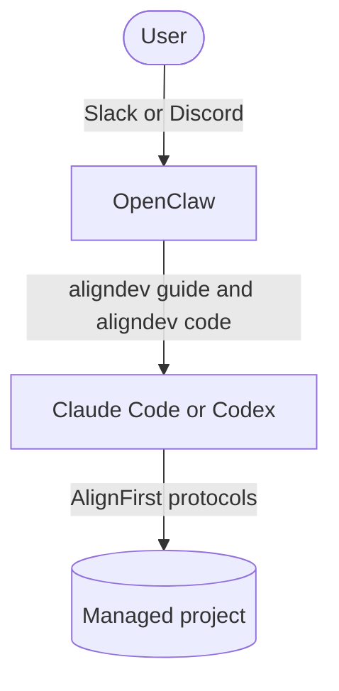

# aligndev

Autonomous software development. You say what you want; the assistant drives the coding agents and brings you the decisions.

See the [product page](https://alignfirst.paroi.tech/aligndev) for an overview.

You talk to an **assistant**, the way you would to a developer on your team. It never touches the code itself. It isolates each task in its own workspace, then hands the investigation and the coding to an AI coding agent, **the agent**, which follows the AlignFirst protocols: specify, plan, implement. The assistant reads the agent's work, tests it, asks you what only you can decide, and opens the pull request.

`aligndev` is the assistant's CLI. It gives the assistant its playbook, launches and tracks the agent, and keeps the inventory of your projects. You never run it yourself: the assistant does.

## The Assistant's Workflow

For each task, the assistant:

1. Discusses the task with the agent and has it write a **spec**.
2. Has it write the **plans**.
3. Has the plans **executed** in a fresh session.
4. Has a **code review** done in another session.
5. Has the review findings **fixed** in yet another session.
6. For UI changes, **tests manually** and checks the dev-server logs.
7. Has fixes made as needed.
8. Takes **screenshots** for good measure.
9. Has the agent **open a draft PR**.

A task can also start at any intermediate step.

## Two Ways to Run the Assistant

**In your coding agent.** A Claude Code, Codex or persistent Pi session becomes the assistant of the repository it starts in. You keep chatting in the same session; the agents it launches work in the background.

**As an OpenClaw bot.** [AlignDev for OpenClaw](#start-as-an-openclaw-bot) deploys the assistant on a server, under its own name in Slack or Discord. It works on every project of the host, one thread per task.

For a coding-agent assistant, parent host and delegated child are independent: `code.agent` selects Claude Code, Codex or Pi. Without that setting, the detected parent kind is the default child. OpenClaw deployment templates still offer Claude Code or Codex.

## Start in Claude Code, Codex or Pi

The project needs an AlignFirst `.plans` directory, in its repository or in a [companion directory](https://github.com/paleo/alignfirst/tree/main/packages/alignfirst#companion-directories). The [setup guide](https://github.com/paleo/alignfirst/blob/main/skills/alignfirst-setup-guide/references/coding-agent-assistant.md) prepares it.

The child needs network access and writes outside the repository. Claude Code/Codex parents request their established sandbox bypass or elevation; approve that request when it comes. Pi uses ordinary OS permissions and saved project trust. It has no implied sandbox or per-command approval boundary, and `code.skipPermissions` has no effect on Pi.

### With the Skill

Install the `aligndev` skill:

```sh
npx skills add https://github.com/paleo/alignfirst --global --skill aligndev
```

Then start a session in the project and invoke `/aligndev` in Claude Code, `$aligndev` in Codex, or `/skill:aligndev` in Pi. To target Pi explicitly, add `--agent pi` to the installer command. Pi discovers global `~/.agents/skills/`; verify the current installer's target/layout when upgrading.

### Pi's Separate Tools

The skill supplies instructions, not executable tools. Install only the package needed by each role:

- **Persistent Pi parent assistant:** `pi install npm:@alignfirst/pi-background` supplies the generic `background` tool. The playbook uses it to launch ordinary `aligndev code new/resume ... --quiet --meta <unique-run-key>` commands. On completion it validates the job handle, then retrieves the exact durable run through `code status <file> --result` or its unique meta key. A one-shot Pi process exits after its answer and cannot serve this role.
- **Pi coding child or direct AlignFirst user:** `pi install npm:@alignfirst/pi-subagent` supplies synchronous isolated plan/review delegation. If parent and child are both Pi, their respective environments need both capabilities. Neither package installs the skill or the other package.

Before replacing a local extension that already registers `subagent`, obtain the user's approval and disable that extension explicitly with `pi config`. Keep existing profiles; do not overwrite them or load two implementations. Reload after installation; `/reload` cancels active jobs and subagents.

Background reporting uses Pi's native follow-up delivery. Manual compaction and cancelled/failed navigation may delay notices until another turn; interruption or queue clearing can lose automatic continuation. Submitted notices may appear after reload/navigation and must be checked for current ownership. There is no exactly-once or crash-recovery guarantee. Normal session shutdown cancels owned work. See the [extension architecture](https://github.com/paleo/alignfirst/blob/main/docs/pi-extensions.md) and each package README for limits.

### Without a Skill

Add this section to your global agent instructions (`~/.claude/CLAUDE.md`, `~/.codex/AGENTS.md`, `~/.pi/agent/AGENTS.md`, or the equivalent):

```markdown
## AlignDev

When the user mentions **aligndev**, follow the `aligndev` playbook if it is already in context. Otherwise, run `npx -y aligndev guide` and follow it.
```

Then ask your session to work with aligndev.

### Requirements

- Node.js 22.11 or later. The assistant runs `aligndev` through `npx`, so there is nothing to install.
- The selected child installed and authenticated: `claude` then `/login`, `codex login`, or `pi` then `/login <provider>` (or configured provider credentials). Pi requires Node.js 22.19 or later; the Pi adapter and extensions target Pi 1.3.0.
- For Pi, select a usable native model, preferably `provider/model` (optional thinking suffix). Authenticate in the same account/configuration used by the child; never expose credential values in diagnostics.
- Linux or macOS, or Windows through WSL.

## Configuration

`~/.alignfirst/aligndev.settings.json` is optional. Without it, every key takes its default. For example, to launch Codex as the agent, whatever runs the assistant, with `sol` as the default model:

```json
{
  "code": { "agent": "codex", "defaultModel": "sol" }
}
```

- `platform` — `codingAgent` (default) for a coding-agent assistant, `openclaw` for an OpenClaw bot.
- `projectsRoot` — the projects directory of an OpenClaw host. Required by `openclaw`. `~/` expands to the home directory; a relative path resolves against `~/.alignfirst/`.
- `code.agent` — the child: `claude`, `codex` or `pi`. Default: the coding agent running the assistant, detected from its environment. Set it to choose another child or resolve mixed host markers. It never selects the parent's launch tool.
- `code.defaultModel` — the model of a new session without `--model`, one of the accepted models. Default: the child's own default. A resumed session keeps its recorded model; Pi resumes require the original worktree.
- `code.models` — a nonempty list restricts accepted selectors. Defaults: Claude's `fable`, `opus`, `sonnet`, `haiku`, or Codex's `astra`, `sol`, `terra`, `luna`. Pi accepts any nonblank native selector by default, preferably `provider/model`; an absent or empty list adds no allowlist.
- `code.skipPermissions` — `true` runs Claude Code with `--dangerously-skip-permissions` instead of `--permission-mode auto`, and Codex with `--dangerously-bypass-approvals-and-sandbox` instead of `--sandbox workspace-write`. Default: `false`. Irrelevant to Pi's ordinary OS permissions.
- `code.unset` — environment variables to hide from the agent, such as an API key meant for another tool on the host.

Unknown keys and invalid values are errors. `aligndev code quota` is unsupported for Pi; consult the selected provider directly.

## Start as an OpenClaw Bot

AlignDev for OpenClaw runs the assistant as an OpenClaw bot. One deployment is a dedicated service account running the assistant under its own name and channel identity. The communication surface, the agent and the assistant's model provider are independent choices. Each task moves from a channel into its own thread, then into an isolated project workspace.



Install the setup skill where your agent will assemble the deployment's private administration repository:

```sh
npx -y skills add https://github.com/paleo/alignfirst --global --skill alignfirst-setup-guide
```

Then ask the agent to create an assistant. The skill collects the deployment values, renders one Slack or Discord variant and one Claude Code or Codex variant, and writes the installation, security, operation and recovery runbooks. Each managed project receives the full preparation contract: the `alignfirst context` section in its `AGENTS.md`, an optional work-files repository, docmap, isolated workspaces and a project-specific `DEVELOPERS.md`.

## Under the Hood

`aligndev` documents itself for the assistant: `aligndev --help`, then `aligndev guide`, print everything it needs. Maintainers: see [aligndev Architecture](https://github.com/paleo/alignfirst/blob/main/docs/aligndev-architecture.md) and the [AlignDev for OpenClaw map](https://github.com/paleo/alignfirst/blob/main/docs/aligndev-openclaw/aligndev-openclaw.md).
