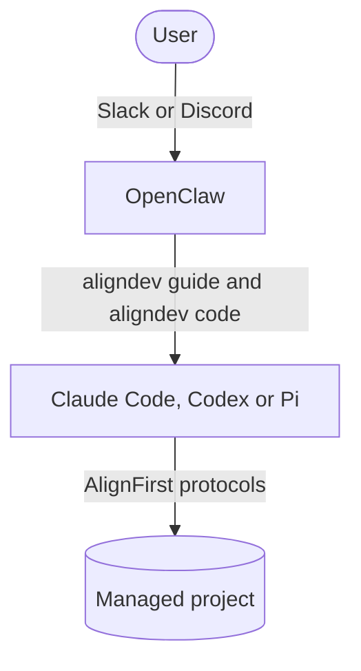

# aligndev

Autonomous software development. You say what you want; the assistant drives the coding agents and brings you the decisions.

See the [product page](https://alignfirst.paroi.tech/aligndev) for an overview.

You talk to an **assistant**, the way you would to a developer on your team. It never touches the code itself. It isolates each task in its own workspace, then hands the investigation and the coding to an AI coding agent, **the agent**, which follows the AlignFirst protocols: specify, plan, implement. The assistant reads the agent's work, tests it, asks you what only you can decide, and opens the pull request.

`aligndev` is the assistant's CLI. It gives the assistant its playbook, launches and tracks the agent, and keeps the inventory of your projects. You never run it yourself: the assistant does.

## The Assistant's Workflow

For each task, the assistant:

1. Discusses the task with the agent and has it write a **spec**.
2. Has it write the **plans**.
3. Has the plans **executed** in a fresh session.
4. Has a **code review** done in another session.
5. Has the review findings **fixed** in yet another session.
6. For UI changes, **tests manually** and checks the dev-server logs.
7. Has fixes made as needed.
8. Takes **screenshots** for good measure.
9. Has the agent **open a draft PR**.

A task can also start at any intermediate step.

## Two Ways to Run the Assistant

**In your coding agent.** A Claude Code, Codex or persistent Pi session becomes the assistant of the repository it starts in. You keep chatting in the same session; the agents it launches work in the background.

**As an OpenClaw bot.** [AlignDev for OpenClaw](#start-as-an-openclaw-bot) deploys the assistant on a server, under its own name in Slack or Discord. It works on every project of the host, one thread per task.

For a coding-agent assistant, parent host and delegated child are independent: a coding profile selects Claude Code, Codex or Pi. Without a named selection, the detected parent kind selects a matching profile or built-in child defaults. OpenClaw deployment templates offer all three agents on Slack or Discord, with explicit profiles and inventoried default/custom native stores. The Pi overlay uses a protected absolute-Node launcher while retaining project PATH. Its [deployment boundary](https://github.com/paleo/alignfirst/blob/main/skills/alignfirst-setup-guide/references/aligndev-openclaw.md#deployment-gate) explicitly permits writable native `auth.json` and adjacent locks for OAuth renewal. That file can persist same-account executable API-key commands; this is account-level persistence, not administrator privilege escalation. Other managed resources and trust retain controlled-maintenance protection. Project trust is not a sandbox, and offline checks do not certify live deployment.

## Start in Claude Code, Codex or Pi

The project needs usable AlignFirst work files, untracked by the project's own repository or in a [companion directory](https://github.com/paleo/alignfirst/tree/main/packages/alignfirst#companion-directories). A separate work-files repository may track them. The [setup guide](https://github.com/paleo/alignfirst/blob/main/skills/alignfirst-setup-guide/references/coding-agent-assistant.md) prepares it. Missing or project-tracked effective plans require authorized companion preparation through `aligndev guide work-files-setup`; existing project content stays untouched and is not copied.

Full workspace tooling is optional. The assistant follows the project's documented tooling when present; otherwise `aligndev worktree` creates or reuses an isolated Git worktree without installation or tracked configuration changes. It shares usable untracked project plans and optional `.local` through locally excluded symlinks, or uses companion plans directly. Readiness covers Git and work files only; dependency installation, builds, tests and application lifecycle follow the repository's commands separately. Removal refuses dirty worktrees, preserves branches and shared targets, and does not stop processes or tear down infrastructure. See `aligndev worktree --help` for the command reference.

The child needs network access and access to its selected work files. Parent-host elevation and the child's permission policy are separate. A shared symlink grants no sandbox permission. In native Codex 0.162.1 host probes, normal `workspace-write` denied writes through shared project `.plans` and `.local` links (`Errno 30`). Prepared companion plans passed through the existing `--add-dir <companion>` route; shared `.local` and outside-root writes remained denied. Report denied real paths. For companion plans, obtain approval through `aligndev guide work-files-setup`, preserving existing project files. Do not silently bypass the sandbox or grant the whole main repository write access.

Pi uses ordinary OS permissions and saved project trust; a profile's `skipPermissions` has no effect. Native Pi 1.3.0 host probes passed for shared plans, a separate work-files repository, companion plans and `.local`. These results establish OS access, not sandbox confinement. Neither agent's host-user probes establish production service-account or deployment support.

### With the Skill

Install the `aligndev` skill:

```sh
npx skills add https://github.com/paleo/alignfirst --global --skill aligndev
```

Then start a session in the project and invoke `/aligndev` in Claude Code, `$aligndev` in Codex, or `/skill:aligndev` in Pi. To target Pi explicitly, add `--agent pi` to the installer command. Pi discovers global `~/.agents/skills/`; verify the current installer's target/layout when upgrading.

### Pi's Separate Tools

The skill supplies instructions, not executable tools. Install only the package needed by each role:

- **Persistent Pi parent assistant:** `pi install npm:@alignfirst/pi-background` supplies the generic `background` tool. The playbook uses it to launch ordinary `aligndev code new/resume ... --quiet --meta <unique-run-key>` commands. On completion it validates the job handle, then retrieves the exact durable run through `code status <file> --result` or its unique meta key. A one-shot Pi process exits after its answer and cannot serve this role.
- **Pi coding child or direct AlignFirst user:** `pi install npm:@alignfirst/pi-subagent` supplies synchronous isolated plan/review delegation. If parent and child are both Pi, their respective environments need both capabilities. Neither package installs the skill or the other package.

Before replacing a local extension that already registers `subagent`, obtain the user's approval and disable that extension explicitly with `pi config`. Keep existing profiles; do not overwrite them or load two implementations. Reload after installation; `/reload` cancels active jobs and subagents.

Background reporting uses Pi's native follow-up delivery. Manual compaction and cancelled/failed navigation may delay notices until another turn; interruption or queue clearing can lose automatic continuation. Submitted notices may appear after reload/navigation and must be checked for current ownership. There is no exactly-once or crash-recovery guarantee. Normal session shutdown cancels owned work. See the [extension architecture](https://github.com/paleo/alignfirst/blob/main/docs/pi-extensions.md) and each package README for limits.

### Without a Skill

Add this section to your global agent instructions (`~/.claude/CLAUDE.md`, `~/.codex/AGENTS.md`, `~/.pi/agent/AGENTS.md`, or the equivalent):

```markdown
## AlignDev

When the user mentions **aligndev**, follow the `aligndev` playbook if it is already in context. Otherwise, run `npx -y aligndev guide` and follow it.
```

Then ask your session to work with aligndev.

### Requirements

- Node.js 22.11 or later. The assistant runs `aligndev` through `npx`, so there is nothing to install.
- The selected child installed and authenticated under the same effective environment and cwd as the child. Apply the profile's `unset/env/configDir`, including HOME, PATH and credential routing, before using `claude` then `/login`, `codex login`, or `pi` then `/login <provider>` (or configured provider credentials). A bare login in another shell may select another account. Pi requires Node.js 22.19 or later; the Pi adapter and extensions target Pi 1.3.0.
- For Pi, select a usable native model, preferably `provider/model` (optional thinking suffix). Authenticate in the same account/configuration used by the child; never expose credential values in diagnostics.
- Linux or macOS, or Windows through WSL.

## Configuration

`~/.alignfirst/aligndev.settings.json` is optional. Without it, one detected parent kind supplies built-in child defaults. A minimal singleton setup is:

```json
{
  "code": {
    "profiles": { "work": { "agent": "claude" } }
  }
}
```

A Claude parent selects `work` automatically. With no detected parent, a sole total profile is also selected. A Codex or Pi parent keeps its own built-ins when no profile matches. Multiple detected kinds require a named selection.

For multiple accounts and independent quota sources:

```json
{
  "code": {
    "profile": "codex-personal",
    "profiles": {
      "codex-personal": { "agent": "codex", "defaultModel": "sol" },
      "claude-personal": {
        "agent": "claude", "default": true, "defaultModel": "opus",
        "unset": ["ANTHROPIC_API_KEY"]
      },
      "claude-work": {
        "agent": "claude", "configDir": "~/.claude-work", "defaultModel": "opus",
        "unset": ["ANTHROPIC_API_KEY"]
      },
      "pi-codex": {
        "agent": "pi", "default": true, "defaultModel": "sol",
        "modelAliases": { "sol": "openai/sol" },
        "quota": { "source": "codex" }
      },
      "pi-anthropic": {
        "agent": "pi", "configDir": "~/.pi/anthropic", "defaultModel": "opus",
        "modelAliases": { "opus": "anthropic/opus" },
        "quota": { "source": "claude" }
      }
    }
  }
}
```

The Pi targets illustrate native shorthand; availability depends on Pi's catalog and account. Exact provider-qualified IDs pin a model. Provider-qualified fuzzy selectors and thinking suffixes pass unchanged to Pi, which owns their resolution. AlignDev neither guesses providers nor implements newest-family ordering.

- `platform` — `codingAgent` (default), or `openclaw`.
- `projectsRoot` — projects directory, required by the OpenClaw playbook. `~/` uses the configured home; relative paths resolve against the settings directory.
- `code.profile` — global named child profile, independent of the parent host.
- `code.profiles` — complete profiles, with required `agent` (`claude`, `codex`, `pi`). Names and references are exact, nonblank strings. Profiles have no inheritance or merging.

Remove `code.profile` above to use automatic per-agent selection: the sole Codex profile, the preferred Claude profile or the preferred Pi profile.

Each profile accepts:

- `default` — optional boolean preference for this profile's agent. With several matching profiles, exactly one true flag selects the preference. Omitted and false are equivalent; a sole matching profile needs no flag. At most one true flag per agent is allowed, even with a named choice. Independent defaults for different agents are valid. The flag never selects an agent kind.
- `configDir` — native directory selection through `CLAUDE_CONFIG_DIR`, `CODEX_HOME`, or `PI_CODING_AGENT_DIR`. Omit it for ordinary setup: the caller's variable is inherited unless `env` or `unset` changes it; without a variable, native defaults apply. `null` deliberately removes that variable to force native-default directory behavior. A string resolves and sets it, including when naming the default path. `~/` uses the configured home; relative paths resolve against the settings directory.
- `env` — literal environment values for non-secret configuration. No interpolation or shell expansion. Keep credentials in native stores or separately provisioned process environments.
- `unset` — inherited variables to remove, including API keys that select an unintended authentication route. A variable cannot occur in both `env` and `unset`. A string or null `configDir` cannot coexist with its native directory variable in either field.
- `defaultModel` — new-session default, validated against accepted names. Omission uses the native default.
- `models` — a nonempty list replaces accepted names. Otherwise Claude accepts `fable`, `opus`, `sonnet`, `haiku`, Codex accepts `astra`, `sol`, `terra`, `luna`, and both add configured alias names. Pi accepts every nonblank selector. An empty list adds no override.
- `modelAliases` — one-step user-facing name → native selector mappings. Validate the chosen name first, expand once, then apply native handling. A Codex alias target such as `sol` still resolves through its bundled catalog.
- `skipPermissions` — defaults to false. Claude uses `--permission-mode auto`, or `--dangerously-skip-permissions`; Codex uses `--sandbox workspace-write`, or `--dangerously-bypass-approvals-and-sandbox`. Pi ignores this setting.
- `quota` — independent native usage reader: `source` is `claude`, `codex`, or `none`, with optional `configDir`, `env`, `unset`. `none` disables quota and accepts no other recognized options. Omitted quota uses a native Claude/Codex profile's coding environment; Pi requires an explicit source.

Selection for new sessions, help, `guide code`, and quota: `--profile` → project registry selection → `code.profile` → automatic resolution. Resume inserts its latest recorded named profile before the global selection. Named choices bypass parent detection; a missing name fails rather than falling through. Automatic resolution selects a sole matching profile or the unique true flag among several matches; without either, several matches are ambiguous. No matching profile uses the detected agent's built-ins. Without a parent, zero or several profiles require a named choice, regardless of flags. Several detected kinds always require a named choice. Project selections use the actual working directory, matching linked worktrees through AlignFirst; help/guide/quota need no `.plans` or Git repository. `--profile` is rejected on status and unrelated guide topics.

`aligndev code quota [--profile <name>]` needs neither a ticket nor `.plans` and starts no coding session. Explicit quota settings start from the original caller environment, apply only their own `unset`, `env` and source-specific `configDir`, then strip parent-session identities. Coding-profile overrides and Pi credentials are not copied into the quota environment. The same path and validation rules apply. Select quota storage only when needed: omission inherits independently from the original caller, null removes the source's native directory variable, and a string selects explicit storage. Pair each Pi profile with the intended Codex or Claude account, using a custom quota directory when account separation is intended. Reports name the profile and native source; the limits belong to that CLI's account. AlignDev does not verify that it matches Pi's account or infer it from a model. Native requests time out after 30 seconds and await bounded process cleanup.

For example, `"configDir": null` forces native-default mode despite an inherited directory variable; `"configDir": "~/.claude-work"` deliberately selects custom Claude storage. On macOS, explicitly setting `CLAUDE_CONFIG_DIR` to the default path can select different Keychain credentials from leaving it unset. Such a string remains valid and is distinct from omission or null. Confirm the intended mode before changing an existing selection; AlignDev performs no settings rewrite, credential transfer or automatic login. A null reset changes only directory routing, not HOME, PATH or API-key precedence.

The child inherits the caller environment, removes `unset`, then applies `env` and the directory selection (setting a string or removing the native variable for null). Parent-session identities are stripped afterward, and required adapter values win. The same finalized environment reaches discovery, execution and native context lookup. Help, guides and failures identify native storage selected through a string `configDir`, a null reset, profile environment overrides, inherited variables or profile removal. They show environment-variable names and origins, never their values. Login must reproduce that effective environment and cwd. No environment values are printed or saved in run metadata.

Resume requires the same native agent and, for Pi, the same real directory. A selected account must contain the native conversation; failure never falls back to an old profile or accepts a new conversation. `--model` overrides the recorded user-facing model; otherwise that name is retained and validated under the current profile. A disallowed retained name requires an explicit replacement; a recorded null keeps the native conversation's model. Profile defaults apply only to new sessions. Retained aliases use the selected profile's current mappings, so changing a mapping can change the native target. Session metadata records profile, agent, chosen name, native ID and cwd; historical records with blank or missing profiles read as null. Unless an explicit, project or global named choice replaces null, resume uses detected built-ins, ignoring configured profile counts and flags, and records null in the new run. No or several detected parents still fail. Original records remain unchanged. A deleted recorded name needs an explicit or project replacement; global selection and inference cannot rescue it. Status reads durable metadata even when launch settings are invalid or a profile has been deleted.

`code.defaultProfiles` is retired and ignored with a warning. Move needed preferences to matching profiles' `default: true`, omit singleton flags and remove the map. Keep profile names unchanged; see [profile-default migration](https://github.com/paleo/alignfirst/blob/main/skills/alignfirst-setup-guide/references/alignfirst-upgrade.md#convert-aligndev-profile-defaults). Unique-profile inference now selects configured native storage, model, environment and permission settings for new runs that previously used built-ins. Historical null-profile resumes retain their built-in fallback. OpenClaw deployments continue to require an explicit valid `code.profile`.

Unknown or obsolete keys at the settings root, `code`, each profile and each quota object are ignored with warnings on stderr. Profile names, environment names and model aliases remain dynamic map keys. Warnings omit values, redact dynamic map names and escape control characters. Recognized invalid values and duplicate defaults still fail. The CLI never rewrites the settings file. Direct `code.agent/defaultModel/models/skipPermissions/unset` settings are retired and ignored; they no longer select or configure a child. Move them manually into a named profile and select it with `code.profile`; see the [upgrade reference](https://github.com/paleo/alignfirst/blob/main/skills/alignfirst-setup-guide/references/alignfirst-upgrade.md#convert-aligndev-launch-settings). Authenticate under the selected native configuration before launching. Never retry against another account after an authentication or missing-conversation failure.

## Start as an OpenClaw Bot

AlignDev for OpenClaw runs the assistant as an OpenClaw bot. One deployment is a dedicated service account running the assistant under its own name and channel identity. The communication surface, the agent and the assistant's model provider are independent choices. Each task moves from a channel into its own thread, then into an isolated project workspace.



Install the setup skill where your agent will assemble the deployment's private administration repository:

```sh
npx -y skills add https://github.com/paleo/alignfirst --global --skill alignfirst-setup-guide
```

Deployments require null or a string for every coding profile and enabled explicit quota source; omission is invalid there. Generated service defaults use null. Inventory still records absolute filesystem paths, while native commands unset the directory variable for null or set its resolved value for a string.

Then ask the agent to create an assistant. The skill collects the deployment values, renders one Slack or Discord variant and one Claude Code, Codex or Pi variant, and writes the installation, security, operation and recovery runbooks. Each managed project receives the preparation contract: project context, usable work files, docmap, runtime procedures and a project-specific `DEVELOPERS.md`, in the repository or its companion. Full workspace tooling is optional; lightweight worktrees provide isolation when it is absent.

## Under the Hood

`aligndev` documents itself for the assistant: `aligndev --help`, then `aligndev guide`, print everything it needs. Maintainers: see [aligndev Architecture](https://github.com/paleo/alignfirst/blob/main/docs/aligndev-architecture.md) and the [AlignDev for OpenClaw map](https://github.com/paleo/alignfirst/blob/main/docs/aligndev-openclaw/aligndev-openclaw.md).
