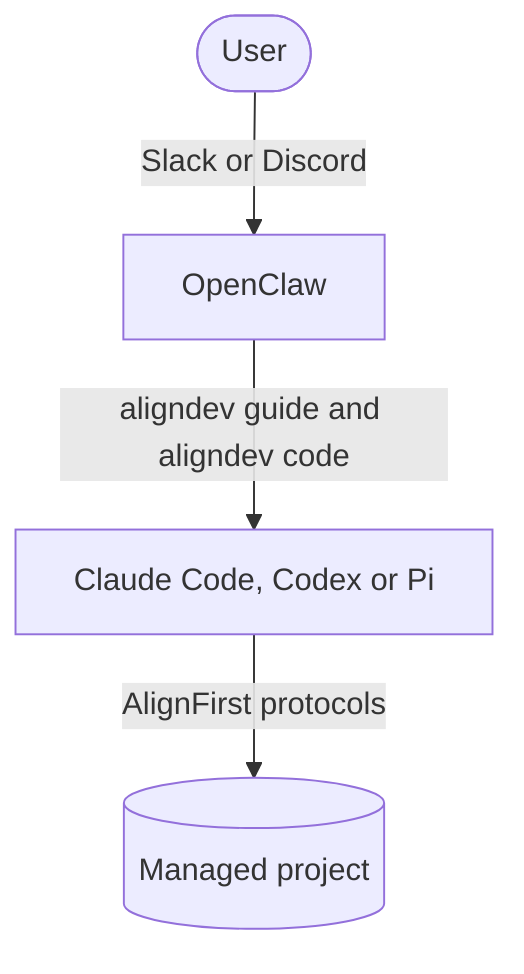

# aligndev

Autonomous software development. You say what you want; the assistant drives the coding agents and brings you the decisions.

See the [product page](https://alignfirst.paroi.tech/aligndev) for an overview.

You talk to an **assistant**, the way you would to a developer on your team. It never touches the code itself. It isolates each task in its own workspace, then hands the investigation and the coding to an AI coding agent, **the agent**, which follows the AlignFirst protocols: specify, plan, implement. The assistant reads the agent's work, tests it, asks you what only you can decide, and opens the pull request.

`aligndev` is the assistant's CLI. It gives the assistant its playbook, launches and tracks the agent, and keeps the inventory of your projects. You never run it yourself: the assistant does.

## The Assistant's Workflow

For each task, the assistant:

1. Sets up the task's **workspace**.
2. Refreshes the default branch and **merges** it into the task branch.
3. Discusses the task with the agent and has it write a **spec**.
4. Has it write the **plans**.
5. Has the plans **executed** in a fresh session.
6. **Tests manually**, takes **screenshots** of UI changes, and checks the dev-server logs.
7. Has fixes made as needed.
8. Has a **code review** done in another session.
9. Has the review findings **fixed** in yet another session.
10. Has the agent **open a PR**.

A task can also start at any intermediate step.

## Two Ways to Run the Assistant

**In your coding agent.** A Claude Code, Codex, Antigravity or persistent Pi session becomes the assistant. Started on a ticket branch, it works on that ticket in place. Started on `main`, it drives several tasks, each in its own worktree, in its repository or in any project you designate by a path. You keep chatting in the same session; the agents it launches work in the background.

**As an OpenClaw bot.** [AlignDev for OpenClaw](#start-as-an-openclaw-bot) deploys the assistant on a server, under its own name in Slack or Discord. It works on every project of the host, one thread per task.

The assistant's harness and the agent's harness are independent: a coding profile selects Claude Code, Codex, Pi or Antigravity for the agent. Without a named selection, the profile that describes the assistant's session selects the agent; without one, a coding-agent assistant uses the built-in defaults of its own harness. OpenClaw deployment templates offer the Claude Code, Codex and Pi agents on Slack or Discord, with explicit profiles and inventoried default/custom native stores. The Pi overlay uses a protected absolute-Node launcher while retaining project PATH. Its [deployment boundary](https://github.com/paleo/alignfirst/blob/main/skills/aligndev-openclaw-setup/SKILL.md#deployment-gate) explicitly permits writable native `auth.json` and adjacent locks for OAuth renewal. That file can persist same-account executable API-key commands; this is account-level persistence, not administrator privilege escalation. Other managed resources and trust retain controlled-maintenance protection. Project trust is not a sandbox, and offline checks do not certify live deployment.

## Configuration boundary

AlignDev requires the workspace-aware `alignfirst config --json` report: top-level `workspace` metadata with absolute registry/runtime paths, `selectionOrigins`, logical locations and independent `aligndev` selection. One selected `alignfirst.json`/`.jsonc` with `schemaVersion: 1` holds nested conventions, plans, optional recipes and the assistant guide path when it is not `ASSISTANTS.md`. Project configuration rejects unknown properties. Companion/global settings retain tolerant warnings. Inventory ranges come only from workspace `devServer.ports`. The scan reads every project's report through one `alignfirst config --json <dir>...` call. `project ports` prints the claimed ranges; `project free-ports --within <first>..<last>` looks up a free block inside the caller's bounds without reserving it.

## Start in Claude Code, Codex, Pi or Antigravity

The project needs usable AlignFirst work files, untracked by the project's own repository or in a [companion directory](https://github.com/paleo/alignfirst/tree/main/packages/alignfirst#companion-directories). A separate work-files repository may track them. To prepare the project, ask your agent to run [`npx -y alignfirst setup guide coding-agent-assistant`](https://github.com/paleo/alignfirst/blob/main/packages/alignfirst/templates/setup/topics/coding-agent-assistant.md). `alignfirst plans check --json` verifies them, from the main worktree or a linked one. AlignFirst refuses effective plans tracked by the project's own repository. Missing or project-tracked effective plans require authorized companion preparation through the `work-files-setup` topic of `aligndev guide`; existing project content stays untouched and is not copied.

The assistant directly runs `alignfirst workspace` for configured and manifest-free projects on every stack. Project recipes live in the selected merged `alignfirst.json`/`.jsonc`, from project or companion; no wrapper or local kernel dependency is required. Prepare usable effective plans and selected runtime storage first. Local storage requires ignored, untracked `.local-wt/`; companion storage needs no checkout runtime directory. Without a manifest, readiness is protocol-ready: no installation, build, ports or services are implied. Coding delegation and project-specific commands remain separate.

External-tool hooks run `npx -y alignfirst workspace setup` inside their selected checkout, then `workspace teardown` before their own deletion. Setup preserves the path/branch and retains partial preparation on failure for retry. Teardown stops/purges and releases state while preserving files and Git; remove additionally performs protected Git deletion and preserves branches. Failed cleanup retains identity even after PIDs exit. An agent removing the workspace directly uses `workspace remove`. See `alignfirst workspace --guide` and [the upgrade runbook](https://github.com/paleo/alignfirst/blob/main/docs/upgrading-multi-stack-workspaces.md).

The child needs network access and access to its selected work files. The assistant's elevation and the agent's permission policy are separate. A shared symlink grants no sandbox permission. In native Codex 0.162.1 host probes, normal `workspace-write` denied writes through shared project `.plans` and `.local` links (`Errno 30`). Prepared companion plans passed through the existing `--add-dir <companion>` route; shared `.local` and outside-root writes remained denied. Report denied real paths. For companion plans, obtain approval through the `work-files-setup` topic of `aligndev guide`, preserving existing project files. Do not silently bypass the sandbox or grant the whole main repository write access.

Pi uses ordinary OS permissions and saved project trust; a profile's `skipPermissions` has no effect. Native Pi 1.3.0 host probes passed for shared plans, a separate work-files repository, companion plans and `.local`. These results establish OS access, not sandbox confinement. Neither agent's host-user probes establish production service-account or deployment support.

Antigravity runs commands in a terminal sandbox without network, so a delegated protocol needs its AlignFirst commands to leave it. See "Antigravity permissions" in `npx -y alignfirst setup guide coding-agent-assistant`.

### With the Skill

Install the `aligndev` skill:

```sh
npx skills add https://github.com/paleo/alignfirst --global --skill aligndev
```

Then start a session in the project and invoke `/aligndev` in Claude Code or Antigravity, `$aligndev` in Codex, or `/skill:aligndev` in Pi. To target Pi explicitly, add `--agent pi` to the installer command. Pi and Antigravity discover global `~/.agents/skills/`; verify the current installer's target/layout when upgrading.

### Pi's Separate Tools

The skill supplies instructions, not executable tools. Install only the package needed by each role:

- **Persistent Pi assistant:** `pi install npm:@alignfirst/pi-background` supplies the generic `background` tool. The playbook uses it to launch ordinary `aligndev code new/resume ... --quiet --meta <unique-run-key>` commands. On completion it validates the job handle, then retrieves the exact durable run through `code status <file> --result` or its unique meta key. A one-shot Pi process exits after its answer and cannot serve this role.
- **Pi agent or direct AlignFirst user:** `pi install npm:@alignfirst/pi-subagent` supplies synchronous isolated plan/review delegation. If the assistant and the agent both run on Pi, their respective environments need both capabilities. Neither package installs the skill or the other package.

Before replacing a local extension that already registers `subagent`, obtain the user's approval and disable that extension explicitly with `pi config`. Keep existing profiles; do not overwrite them or load two implementations. Reload after installation; `/reload` cancels active jobs and subagents.

Background reporting uses Pi's native follow-up delivery. Manual compaction and cancelled/failed navigation may delay notices until another turn; interruption or queue clearing can lose automatic continuation. Submitted notices may appear after reload/navigation and must be checked for current ownership. There is no exactly-once or crash-recovery guarantee. Normal session shutdown cancels owned work. See the [extension architecture](https://github.com/paleo/alignfirst/blob/main/docs/pi-extensions.md) and each package README for limits.

### Without a Skill

Add this section to your global agent instructions (`~/.claude/CLAUDE.md`, `~/.codex/AGENTS.md`, `~/.pi/agent/AGENTS.md`, `~/.gemini/AGENTS.md`, or the equivalent):

```markdown
## AlignDev

When the user mentions **aligndev**, follow the `aligndev` playbook if it is already in context. Otherwise, run `npx -y aligndev guide` and follow it. If your sandbox blocks `npx -y aligndev guide`, rerun it outside the sandbox. With Bun instead of Node.js, replace `npx -y` with `bunx --bun`.
```

Then ask your session to work with aligndev.

### Requirements

- Node.js 22.13 or later with `npx -y aligndev`, or Bun with `bunx aligndev` (`bun x` is equivalent). Bun 1.4.4 is the tested CLI baseline; compatibility with every older release is not promised.
- The selected child installed and authenticated under the same effective environment and cwd as the child. `aligndev code --help` prints the login command of the selected profile, and so does a run that ends with `auth_required`. The command applies the profile's `unset/env/configDir` to `claude` then `/login`, `codex login`, `pi` then `/login <provider>` (or configured provider credentials), or `agy` then sign in. A bare login in another shell may select another account. Pi keeps its own runtime requirements; see the [extension compatibility baseline](https://github.com/paleo/alignfirst/blob/main/docs/pi-extensions.md#supported-and-tested-baseline).
- For Pi, declare the models in the profile: see `modelFamilies` under [Settings](#settings). Authenticate in the same account/configuration used by the child; never expose credential values in diagnostics.
- Linux or macOS, or Windows through WSL.

Published bins retain Node shebangs. Ordinary `bunx aligndev` runs Node when it is installed and Bun when Node is absent; `--bun` selects Bun explicitly. Direct `bun <installed-entry.mjs>` and transparent project scripts launched with `bun --bun run <script>` preserve Bun in follow-up commands and internal AlignFirst calls. npm scripts retain their `--` argument separator.

Bun support covers this CLI, not its selected coding agent, Docker or an OpenClaw deployment. Those tools keep their own runtime, installation and authentication requirements; selecting Bun for AlignDev never forces the coding agent to use Bun.

## Configuration

`~/.alignfirst/aligndev.settings.json` is optional. Without it, a Claude Code, Codex, Pi or Antigravity assistant delegates with the built-in defaults of its own harness. A minimal setup is:

```json
{
  "code": {
    "profiles": { "work": { "harness": "claude" } }
  }
}
```

A Claude Code assistant selects `work`: a profile without `configDir` describes any session of its harness. A Codex, Pi or Antigravity assistant keeps its own built-ins.

### The Assistant's Harness

A harness is the software that runs a session: `claude`, `codex`, `pi`, `agy` or `openclaw`. The assistant's harness runs the session that calls `aligndev`; the agent's harness runs the coding agent. `aligndev` resolves the assistant's harness at each invocation:

1. `ALIGNDEV_ASSISTANT_HARNESS`, when set: one of the five values. Any other value is an error.
2. The detected coding agent, read from its session variables, such as `ANTIGRAVITY_AGENT=1` for Antigravity. Several detected agents leave the harness unrecognized.
3. `OPENCLAW_SHELL=exec`, set by OpenClaw's exec runtime: `openclaw`.
4. Otherwise, the harness is unrecognized.

An agent launched from OpenClaw inherits `OPENCLAW_SHELL`, so detection comes first. The agent does not inherit `ALIGNDEV_ASSISTANT_HARNESS`: it applies to one invocation. An operator shell on an OpenClaw account sets it to `openclaw` to read the OpenClaw guides.

The harness selects the playbook: OpenClaw's for `openclaw`, the coding-agent playbook otherwise. Under OpenClaw, `aligndev guide` takes `--channel <slack|discord|app>`: a Slack or Discord thread and an app conversation are separate contexts, each with its own topics. Every playbook topic requires it, `code` defaults to `app`, and `project` rejects it.

### Settings

For multiple accounts and independent quota sources:

```json
{
  "code": {
    "profiles": {
      "claude-personal": {
        "harness": "claude", "configDir": null, "defaultAgentProfile": "codex-personal",
        "unset": ["ANTHROPIC_API_KEY"]
      },
      "claude-work": {
        "harness": "claude", "configDir": "~/.claude-work", "defaultModel": "opus",
        "unset": ["ANTHROPIC_API_KEY"]
      },
      "codex-personal": { "harness": "codex", "defaultModel": "sol" },
      "pi-codex": {
        "harness": "pi", "defaultModel": "sol",
        "modelFamilies": { "gpt": "openai" },
        "quota": { "source": "codex" }
      },
      "pi-anthropic": {
        "harness": "pi", "configDir": "~/.pi/anthropic", "defaultModel": "opus",
        "modelFamilies": { "claude": "anthropic" },
        "quota": { "source": "claude" },
        "disabled": true
      }
    }
  }
}
```

A Claude Code session without `CLAUDE_CONFIG_DIR` is described by `claude-personal` and delegates to `codex-personal`. A session whose `CLAUDE_CONFIG_DIR` is `~/.claude-work` is described by `claude-work` and delegates to it. A Pi assistant delegates to `pi-codex`; `pi-anthropic` is disabled.

A Pi profile accepts only the models it declares. The `modelFamilies` of `pi-codex` declares `astra`, `sol`, `terra` and `luna`: `sol` selects the newest `gpt-…-sol` model that Pi lists under its `openai` provider. `pi-anthropic` declares `fable`, `opus`, `sonnet` and `haiku` under `anthropic`. Availability depends on Pi's catalog and credentials.

On an account shared by OpenClaw and coding-agent sessions:

```json
{
  "projectsRoot": "~/projects",
  "code": {
    "fallbackProfile": "service-pi",
    "profiles": {
      "openclaw": { "harness": "openclaw", "defaultAgentProfile": "service-pi" },
      "service-pi": { "harness": "pi", "configDir": null },
      "service-codex": { "harness": "codex", "configDir": null }
    }
  }
}
```

OpenClaw sessions delegate to `service-pi`. A Codex session on that account is described by `service-codex` and delegates to it. A shell without a recognized harness uses `code.fallbackProfile`.

- `projectsRoot` — projects directory, required by the OpenClaw playbook. `~/` uses the configured home; relative paths resolve against the settings directory.
- `code.profiles` — named profiles, each with a required `harness`. Names and references are exact, nonblank strings. Profiles have no inheritance or merging.
- `code.fallbackProfile` — the profile used when the assistant has no profile and its harness has no built-in defaults: an `openclaw` harness without an `openclaw` profile, or an unrecognized harness.

A coding-agent profile accepts:

- `harness` — `claude`, `codex`, `pi` or `agy`: the agent's harness.
- `defaultAgentProfile` — the profile a session delegates to when this profile is the assistant's profile. Without it, the profile delegates to itself. It is followed once.
- `disabled` — `true` makes the profile absent for the CLI. Its shape is still validated.
- `default` — optional boolean. When several enabled profiles describe the session, the one flagged true is the assistant's profile. At most one true flag per harness is allowed among enabled profiles, even with a named choice. Omitted and false are equivalent.
- `configDir` — native directory selection through `CLAUDE_CONFIG_DIR`, `CODEX_HOME`, or `PI_CODING_AGENT_DIR`. An `agy` profile rejects it: Antigravity has one native store and one account per OS user. Omit it for ordinary setup: the caller's variable is inherited unless `env` or `unset` changes it; without a variable, native defaults apply. `null` deliberately removes that variable to force native-default directory behavior. A string resolves and sets it, including when naming the default path. `~/` uses the configured home; relative paths resolve against the settings directory. The same value decides which sessions the profile describes: `null` a session whose variable is unset, a path a session whose variable names the same directory, and omitted any session that no `null` or path profile describes. A variable set to the native default path does not match `null`.
- `env` — literal environment values for non-secret configuration. No interpolation or shell expansion. Keep credentials in native stores or separately provisioned process environments.
- `unset` — inherited variables to remove, including API keys that select an unintended authentication route. A variable cannot occur in both `env` and `unset`. A string or null `configDir` cannot coexist with its native directory variable in either field.
- `defaultModel` — new-session default, validated against accepted names. Omission uses the native default.
- `models` — the accepted model names, in the order the assistant sees them: biggest model first. Without it, or with an empty list, a profile accepts its built-in aliases, then its `modelAliases` names. A profile that mixes families or adds names declares `models` to set the order. A Pi profile that declares nothing accepts no model: it runs Pi's own default and rejects `--model` and `defaultModel`. Built-in aliases go from the biggest model to the smallest:

  | Harness | Built-in aliases | Pattern |
  | --- | --- | --- |
  | `claude` | `fable`, `opus`, `sonnet`, `haiku` | none: the name passes unchanged |
  | `codex` | `astra`, `sol`, `terra`, `luna` | `gpt-{latest}-<alias>` |
  | `agy` | `carbon`, `neon`, `hydrogen`, `flash` | `gemini-{latest}-<alias>` |
  | `pi` | those of its `modelFamilies`, in the order of the settings | see `modelFamilies` |
- `modelFamilies` — Pi only. Maps a model family to the text placed before its model names: the Pi provider as the first column of `pi --list-models` prints it, optionally followed by the id prefix of a gateway, as in `openrouter/openai`. Each entry declares the aliases of its family:

  | Family | Aliases | Pattern |
  | --- | --- | --- |
  | `gpt` | `astra`, `sol`, `terra`, `luna` | `<prefix>/gpt-{latest}-<alias>` |
  | `claude` | `fable`, `opus`, `sonnet`, `haiku` | `<prefix>/claude-<alias>-{latest}` |
  | `gemini` | `carbon`, `neon`, `hydrogen`, `flash` | `<prefix>/gemini-{latest}-<alias>` |

  An id of another shape, such as Bedrock's `us.anthropic.claude-opus-…`, is declared through `modelAliases`.
- `modelAliases` — maps a name to a selector. AlignDev validates the chosen name, expands it once, then replaces a built-in alias with its pattern. An entry named like a built-in alias overrides it. A full native selector pins one model, as in `"kimi": "moonshotai/kimi-k3.1-pro"`. A selector with `{latest}` follows the newest version, as in `"glm": "zai/glm-{latest}"` for the `glm` models of Pi's `zai` provider: see [Model Patterns](#model-patterns).
- `efforts` — a nonempty list replaces the harness's built-in effort levels and bounds what AlignDev passes. An empty list adds no override. Entries are free strings, so a level AlignDev does not know can be listed.
- `defaultEffort` — pins new sessions to one of the accepted levels. Without it, a session launched without `--effort` runs at the native default, which AlignDev does not read.

  | Harness | Built-in levels | Native argument |
  | --- | --- | --- |
  | `claude` | `low`, `medium`, `high`, `xhigh`, `max` | `--effort <level>` |
  | `codex` | `low`, `medium`, `high`, `xhigh`, `max`, `ultra` | `-c model_reasoning_effort="<level>"` |
  | `pi` | `off`, `minimal`, `low`, `medium`, `high`, `xhigh`, `max` | `--thinking <level>` |
  | `agy` | `low`, `medium`, `high`, `xhigh`, `max` | `--effort <level>` |

  The level reaches the native CLI unchanged. AlignDev checks no level against the model: Claude falls back to a supported level, Pi clamps it, Codex passes it through, and Antigravity fails the run on a level the model lacks.
- `skipPermissions` — defaults to false. Claude uses `--permission-mode auto`, or `--dangerously-skip-permissions`; Codex uses `--sandbox workspace-write`, or `--dangerously-bypass-approvals-and-sandbox`; Antigravity uses its auto mode, or `--dangerously-skip-permissions` (see "Antigravity permissions" in `npx -y alignfirst setup guide coding-agent-assistant`). Pi ignores this setting.
- `quota` — independent native usage reader: `source` is `claude`, `codex`, `agy` or `none`, with optional `configDir`, `env`, `unset`. An `agy` source rejects `configDir`. `none` disables quota and accepts no other recognized options. Omitted quota uses a native Claude, Codex or Antigravity profile's coding environment; Pi requires an explicit source.

An `openclaw` profile describes an OpenClaw assistant and launches nothing. It accepts `harness`, a required `defaultAgentProfile` and `disabled`; any other recognized profile key is an error. At most one is enabled.

### Selection

The assistant's profile is the enabled profile that describes the session: the `openclaw` profile under OpenClaw, or a profile of the session's coding-agent harness whose `configDir` matches. An exact `configDir` match wins over an omitted one. Among several candidates, the one flagged `default: true` wins; without a flag, the launch fails and lists them.

Selection for new sessions, help, `guide code`, and quota:

1. `--profile`.
2. The project registry selection.
3. On resume, the latest recorded named profile.
4. The assistant profile's `defaultAgentProfile`, or the assistant's profile itself.
5. Without an assistant's profile: the built-in defaults of a Claude Code, Codex, Pi or Antigravity harness, or `code.fallbackProfile` for an `openclaw` or unrecognized harness. Without that key, the error names the remedies; with one enabled coding-agent profile, it prints the line to add.

A named reference never falls through: a `--profile`, project selection, recorded profile, `defaultAgentProfile` or `code.fallbackProfile` that names a missing, disabled or `openclaw` profile fails. Project selections use the actual working directory, matching linked worktrees through AlignFirst; help, guide, quota and models need no `.plans` or Git repository. `--profile` is rejected on status and unrelated guide topics. `aligndev guide code` lists every enabled coding-agent profile with its harness and models, so the assistant passes `--profile <name>` for another agent or account.

`aligndev code quota [--profile <name>]` needs neither a ticket nor `.plans` and starts no coding session. Explicit quota settings start from the caller environment without its launcher variables, apply only their own `unset`, `env` and source-specific `configDir`, then strip the assistant's session identities. Coding-profile overrides and Pi credentials are not copied into the quota environment. The same path and validation rules apply. Select quota storage only when needed: omission inherits independently from the original caller, null removes the source's native directory variable, and a string selects explicit storage. Pair each Pi profile with the intended Codex or Claude account, using a custom quota directory when account separation is intended. Reports name the profile and native source; the limits belong to that CLI's account. AlignDev does not verify that it matches Pi's account or infer it from a model. Native requests time out after 30 seconds and await bounded process cleanup.

For example, `"configDir": null` forces native-default mode despite an inherited directory variable; `"configDir": "~/.claude-work"` deliberately selects custom Claude storage. On macOS, explicitly setting `CLAUDE_CONFIG_DIR` to the default path can select different Keychain credentials from leaving it unset. Such a string remains valid and is distinct from omission or null. Confirm the intended mode before changing an existing selection; AlignDev performs no settings rewrite, credential transfer or automatic login. A null reset changes only directory routing, not HOME, PATH or API-key precedence.

### Model Patterns

A selector that holds `{latest}` is a pattern, in a `modelAliases` target or a `models` entry. The placeholder stands for a version, and AlignDev selects the newest one in the model list it remembers (see [The AlignDev Memory](#the-aligndev-memory)). The built-in aliases of `codex`, `agy` and `modelFamilies` are patterns. A `claude` profile rejects `{latest}`: Claude Code resolves its model names itself.

- A pattern holds `{latest}` once and matches a whole name, so a variant with a further suffix never matches. A pattern takes no thinking suffix.
- A version is a major number, optionally followed by `.` or `-` and a minor number, each of one to three digits. `{latest}` therefore never stands for a date.
- The launch fails when several names share the newest version.
- Antigravity lists each model once per effort level. A pattern matches such an id with or without its effort ending, and selects the id without it.

### The AlignDev Memory

`~/.alignfirst/aligndev.store.sqlite` is the AlignDev memory: a SQLite file shared by the AlignDev instances of the OS account, created at the first use. It holds paths and native CLI versions, so it stays local to the machine.

The memory keeps the model list of each harness and profile, so a `{latest}` pattern needs no catalog command at each launch. A Pi extension can add models, and Pi loads the project extensions from `.pi` in its working directory. So a working directory that holds `.pi` has its own Pi lists. A launch reads the native CLI version (`codex --version`, `pi --version` or `agy --version`), then resolves from the remembered list. The catalog command runs again when the list is missing, on the first use of a day, after an upgrade of the native CLI or a change of its native directory, and when the list cannot resolve the pattern. When the command fails, the list of the same native directory still serves if it resolves the pattern.

`aligndev code models [--profile <name>] [--refresh]` shows the accepted names of each enabled profile, or of the given one, and the model each name selects in the remembered list. `--refresh` looks the lists up again first, and exits with 1 when a pattern has no single match. A fixed selector is shown as written: the first launch checks it.

AlignDev works without the memory. When the file cannot be opened, read or written, or comes from a newer AlignDev, AlignDev leaves it untouched and runs the catalog command at each launch. `aligndev code models` reports the reason.

### Global Assistant Instructions

`~/.alignfirst/ASSISTANTS.md` is optional. It holds the assistant instructions that apply to every project, such as:

```markdown
Use the `claude` profile by default, `pi` for code reviews and `agy` for consultations.
```

The instructions select among the profiles of `aligndev.settings.json` by name; a missing profile fails the launch. The assistant applies such an instruction through `--profile`, which outranks a project's profile selection in the companion registry.

`aligndev guide` prints the file at the start of every session, and on every activation under OpenClaw. Keep it short: past about 20,000 characters, a harness may truncate it.

Rules for the coding agents stay in each harness's own global files.

### Agent Environment

The agent inherits the caller environment without what a package launcher injected: every lowercase `npm_*` variable, `INIT_CWD`, `NODE` when it equals `npm_node_execpath`, and the leading PATH entries that end in `node_modules/.bin` or `node-gyp-bin`. Uppercase variables such as `NPM_TOKEN` stay. To pass npm settings to the agent, use `.npmrc`, an uppercase `NPM_CONFIG_*` variable or the profile's `env`. It then removes `unset`, and applies `env` and the directory selection (setting a string or removing the native variable for null). Every coding agent's session identity, `AI_AGENT` included, and `ALIGNDEV_ASSISTANT_HARNESS` are stripped afterward, and required adapter values win. `OPENCLAW_SHELL`, the trace variables `TRACEPARENT` and `TRACESTATE`, and host-app variables such as `PASEO_AGENT_ID` pass through; list them in `unset` to remove them. The same finalized environment reaches discovery, execution and native context lookup. Help, guides and failures identify native storage selected through a string `configDir`, a null reset, profile environment overrides, inherited variables or profile removal. They show environment-variable names and origins, never their values. Login must reproduce that effective environment and cwd. No environment values are printed or saved in run metadata.

### Resume

Resume requires the same native agent and, for Pi, the same real directory. A selected account must contain the native conversation; failure never falls back to an old profile or accepts a new conversation. An unknown conversation fails the run, and the child is stopped before it executes the prompt. `--model` overrides the recorded user-facing model; otherwise that name is retained and validated under the current profile. A disallowed retained name requires an explicit replacement; a recorded null keeps the native conversation's model. `--effort` likewise overrides the recorded effort; otherwise it is retained and validated under the current profile, and a recorded null keeps the native default. AlignDev passes the effective effort on every run, new or resumed. Profile defaults apply only to new sessions. Retained aliases use the selected profile's current mappings, so changing a mapping can change the native target. Session metadata records profile, agent, chosen name, native ID and cwd; historical records with blank or missing profiles read as null. Unless `--profile` or a project registry selection replaces null, resume uses the built-ins of the assistant's harness, ignoring configured profiles and flags, and records null in the new run. An `openclaw` or unrecognized harness fails. Original records remain unchanged. A deleted recorded name needs `--profile` or a project replacement; automatic selection cannot rescue it. Status reads durable metadata even when launch settings are invalid or a profile has been deleted.

### Retired Keys

Unknown or obsolete keys at the settings root, `code`, each profile and each quota object are ignored with warnings on stderr. Profile names, environment names and model aliases remain dynamic map keys. Warnings omit values, redact dynamic map names and escape control characters. Recognized invalid values and duplicate defaults still fail. The CLI never rewrites the settings file.

- `platform` — the assistant's harness is resolved at each invocation.
- `portRange` — pass the bounds to `aligndev project free-ports --within <first>..<last>`, and state a deployment's range in its own instructions.
- `code.profile` — set the assistant profile's `defaultAgentProfile`, or `code.fallbackProfile`.
- A profile's `agent` — renamed `harness`. As a one-off exception, a profile with `agent` and no `harness` still loads: `agent` reads as `harness`, with a deprecation warning. Beside `harness`, `agent` is ignored. See [harness-settings conversion](https://github.com/paleo/alignfirst/blob/main/packages/alignfirst/templates/setup/topics/upgrade.md#convert-aligndev-harness-settings).
- `code.defaultProfiles` — move needed preferences to matching profiles' `default: true` and remove the map. Keep profile names unchanged; see [profile-default migration](https://github.com/paleo/alignfirst/blob/main/packages/alignfirst/templates/setup/topics/upgrade.md#convert-aligndev-profile-defaults).
- Direct `code.agent/defaultModel/models/skipPermissions/unset` — they no longer select or configure an agent. Move them manually into a named profile and select it through the assistant profile's `defaultAgentProfile` or `code.fallbackProfile`; see the [upgrade reference](https://github.com/paleo/alignfirst/blob/main/packages/alignfirst/templates/setup/topics/upgrade.md#convert-aligndev-launch-settings).

Authenticate under the selected native configuration before launching. Never retry against another account after an authentication or missing-conversation failure.

## Start as an OpenClaw Bot

AlignDev for OpenClaw runs the assistant as an OpenClaw bot. One deployment is a dedicated service account running the assistant under its own name and channel identity. The communication surface, the agent and the assistant's model provider are independent choices. Each task moves from a channel into its own thread, then into an isolated project workspace.



Install the `aligndev-openclaw-setup` skill where your agent will assemble the deployment's private administration repository:

```sh
npx -y skills add https://github.com/paleo/alignfirst --global --skill aligndev-openclaw-setup
```

A deployment runs `alignfirst` and `aligndev` through `npx -y`, so the playbook follows each release. Its settings hold an `openclaw` profile whose `defaultAgentProfile` names the service profile. Deployments require null or a string for every enabled coding profile and enabled explicit quota source; omission is invalid there. Generated service defaults use null. Inventory still records absolute filesystem paths, while native commands unset the directory variable for null or set its resolved value for a string.

Then ask the agent to create an assistant. The skill collects the deployment values, renders one Slack or Discord variant and one Claude Code, Codex or Pi variant, and writes the installation, security, operation and recovery runbooks. Each managed project receives the preparation contract: project context, usable work files, docmap, runtime procedures and an assistant guide, `ASSISTANTS.md` by default, in the repository or its companion. `alignfirst assistant-instructions` prints the project guidance, then the assistant guide. The workspace recipe is optional; default preparation is protocol-ready.

## Maintainer checks

From the repository root, run the complete `npm run build`, then `npm run test:integration --workspace aligndev`. Filtered integration files require the same build. Preflight checks provisioning only; rebuild after source changes.

## Under the Hood

`aligndev` documents itself for the assistant: `aligndev --help`, then `aligndev guide`, print everything it needs. Maintainers: see [aligndev Architecture](https://github.com/paleo/alignfirst/blob/main/docs/aligndev-architecture.md) and the [AlignDev for OpenClaw map](https://github.com/paleo/alignfirst/blob/main/docs/aligndev-openclaw/aligndev-openclaw.md).
